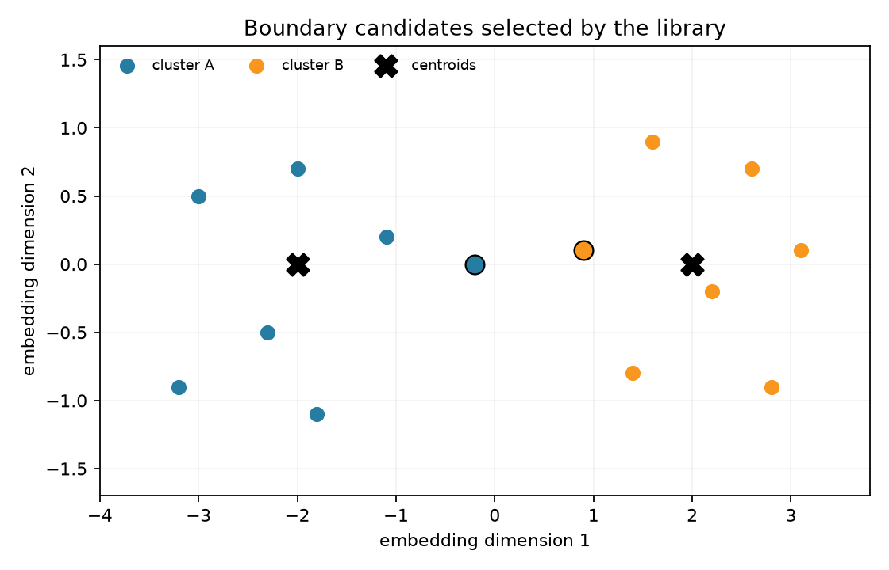

# Visualize boundary candidates

Install `pip install -e ".[viz]"` for plotting. This example ranks points by
their Voronoi ratio, projects them to 2D with PCA, and highlights the top three
from each cluster. The static PNG and interactive HTML go to the ignored
`docs/_build` directory.

```python
from pathlib import Path

from topic_boundaries import (
    JsonlSource,
    Settings,
    embed_and_cluster_datapoints,
    voronoi_rankings,
)
from topic_boundaries.visualization import (
    build_plotly_figure,
    export_png,
    project_to_2d,
)

settings = Settings.from_config()
datapoints = JsonlSource("datasets/sample.jsonl").load()
vectors, labels, centroids = embed_and_cluster_datapoints(
    datapoints,
    n_clusters=5,
    embedding_model=settings.embedding_model,
    kmeans_random_state=settings.kmeans_random_state,
    kmeans_n_init=settings.kmeans_n_init,
)
hits = voronoi_rankings(datapoints, vectors, labels, centroids, 5, top_n_per_cluster=3)
highlight_ids = {hit.doc_id for hit in hits}
highlight = {i for i, point in enumerate(datapoints) if point.doc_id in highlight_ids}
xy_docs, xy_centroids = project_to_2d(
    vectors, labels, centroids,
    method="pca", random_state=42, tsne_perplexity=5,
)

output = Path("docs/_build")
output.mkdir(parents=True, exist_ok=True)
png = export_png(labels, highlight, xy_docs, xy_centroids, output / "boundary-example.png")
figure = build_plotly_figure(
    datapoints, labels, highlight, xy_docs, xy_centroids,
    title="Voronoi boundary candidates",
)
figure.write_html(output / "boundary-example.html")
print(png, output / "boundary-example.html")
```

The 2D projection helps inspect clusters, but the boundary method ranks in
the original vector space. A projected overlap does not prove a high-dimensional
boundary. See [Boundary Methods](../concepts/boundary_methods.md) for the scores.

This illustration's larger outlined points are the highest Voronoi-ratio
candidates selected by `voronoi_rankings` in each cluster:


